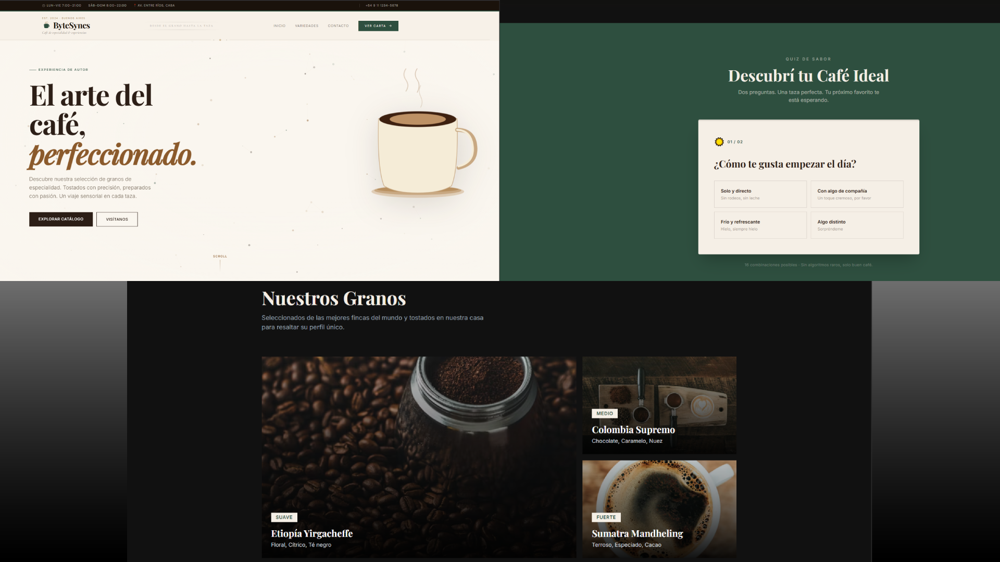
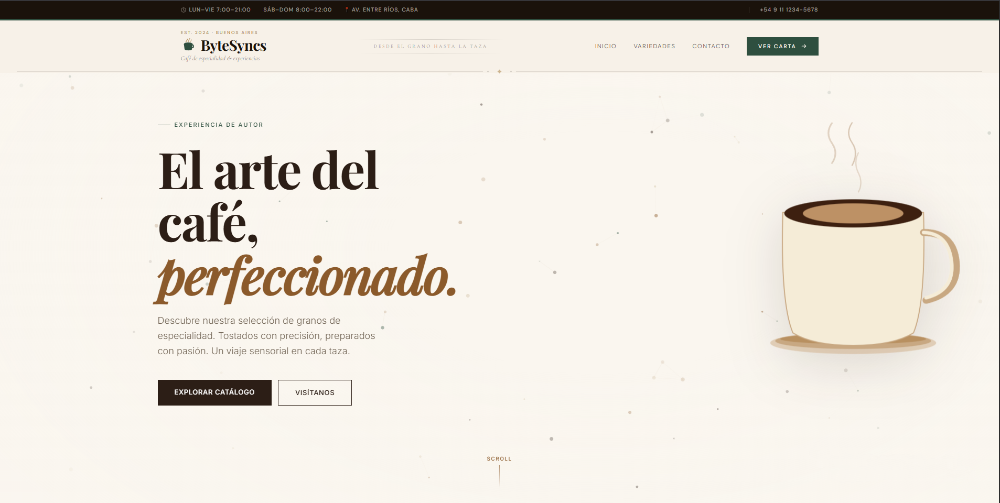
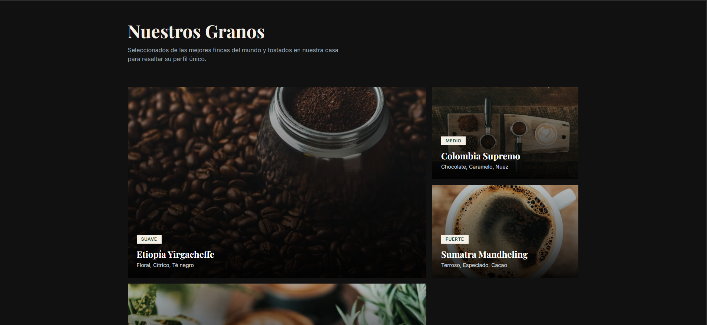
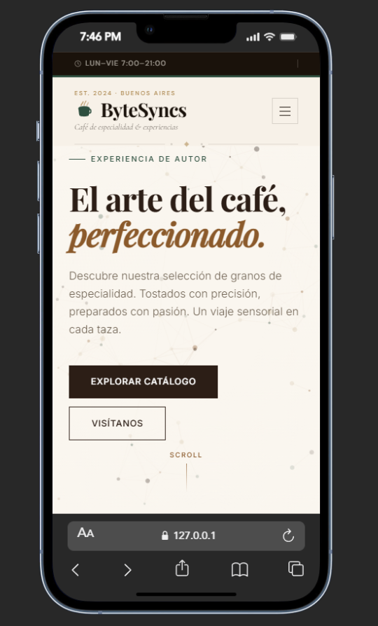

# ☕ Coffee Website — Demo Project



---

## 📌 Overview

This project is a **commercial demo website** built to ներկայաց a modern, elegant, and responsive web experience for a coffee-related business.

It is intended exclusively for **client presentation purposes**, showcasing design, layout, and functionality before final development and delivery.

> ⚠️ This is **not an open-source project**. See the license section for details.

---

## ✨ Features

- Modern and responsive UI/UX
- Clean and minimal design focused on branding
- Smooth layout and visual hierarchy
- Optimized performance with static generation
- Scalable structure for real-world implementation

---

## 🖼️ Preview

### 🏠 Hero Section



### 📋 Content Layout



### 📱 Responsive Design



---

## 🛠️ Tech Stack

- **Astro** — Static site generation and performance optimization
- **Tailwind CSS** — Utility-first styling
- **TypeScript** — Type-safe development

---

## 🚀 Purpose

This project serves as a **visual and functional prototype** to:

- Present design concepts to clients
- Validate layout and user experience
- Provide a foundation for a production-ready website

---

## 🔒 License

```
All rights reserved.

This project is a commercial demo and is not open source.

You may not copy, reproduce, distribute, modify, or use this project, in whole or in part, for any purpose without explicit written permission from the author.
```

---

## 📩 Contact

For licensing, collaboration, or project inquiries:

**Email:** [info.bytesyncs@gmail.com](mailto:info.bytesyncs@gmail.com)

---

## ⚠️ Disclaimer

This repository contains proprietary work intended solely for demonstration.
Unauthorized use of this code or design is strictly prohibited.

---

## 💡 Notes

- Images used in this README are for illustrative purposes
- Final implementation may vary based on client requirements
- This demo can be adapted and extended into a full production project

---

<div align="center">

**© 2026 — All rights reserved**

</div>
